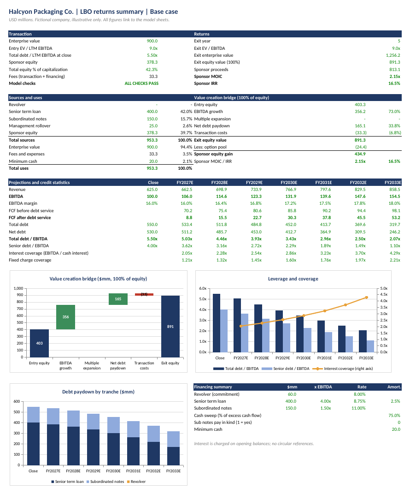
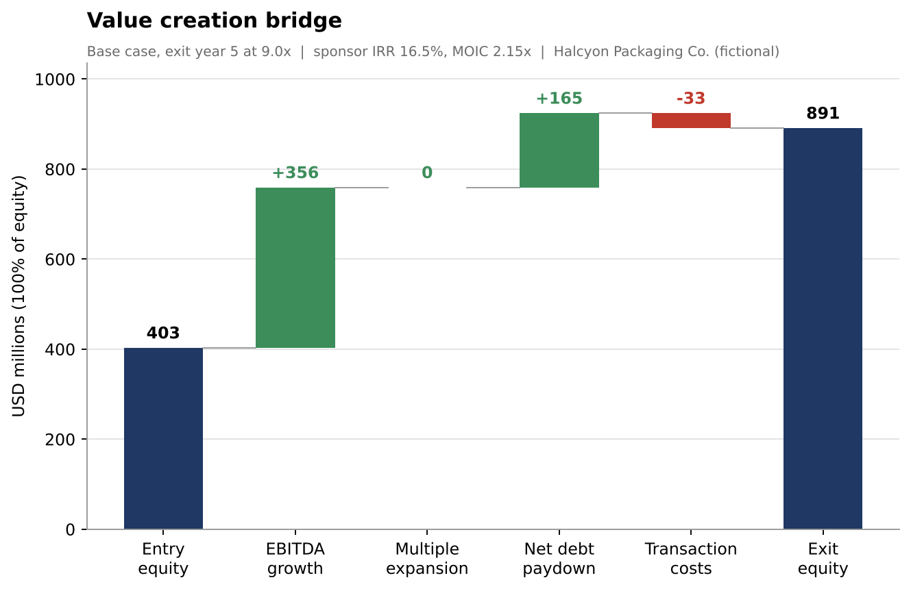
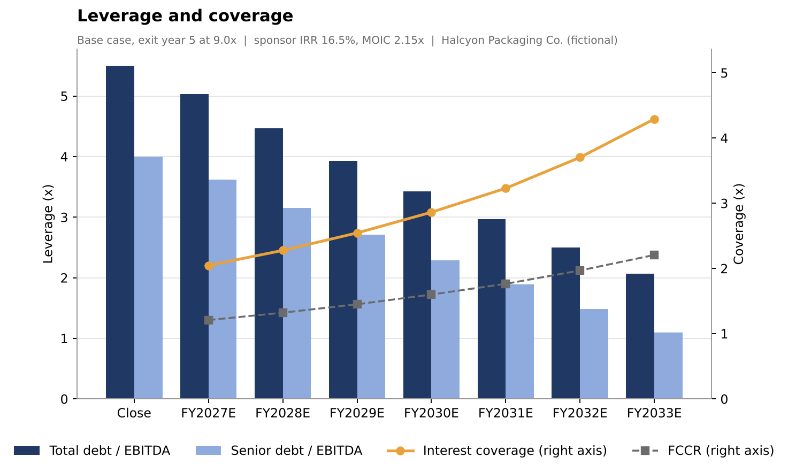
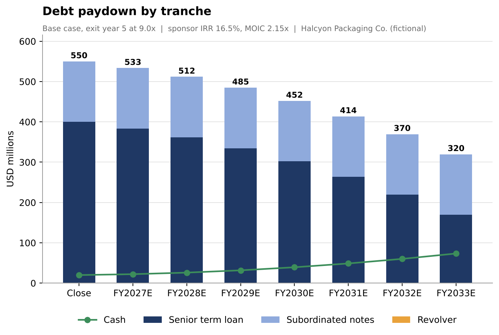
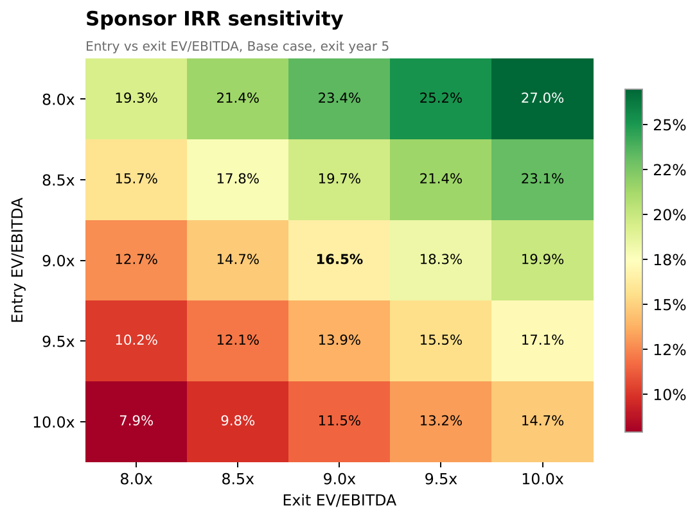

# lbo-lab

[](https://github.com/adhamkarim4815/lbo-lab/actions/workflows/ci.yml)


A leveraged buyout model built two ways that have to agree: a **Python engine and CLI**, and a **banker-formatted Excel workbook where every number is a live formula** driven by one Inputs sheet. A test suite recalculates the workbook in headless LibreOffice and reconciles it to the engine cell by cell, in every scenario.

The target is **Halcyon Packaging Co., a fictional company**. All figures are illustrative.



*The Summary sheet of `examples/halcyon_lbo.xlsx` (Base case), rendered to PDF by LibreOffice. Every figure on it is a formula.*

## What it does

- **Transaction**: LTM EBITDA, entry EV/EBITDA, transaction and financing fees, minimum cash, sources and uses, capitalization table.
- **Capital structure**: revolver (draws and repays automatically), senior term loan (mandatory amortization by year plus a cash sweep), subordinated notes with an optional PIK toggle.
- **Projections** (7 years): revenue growth, EBITDA margin, D&A, capex, change in NWC, taxes after interest. Free cash flow before and after debt service.
- **Credit statistics** by year: total, senior and net leverage, interest coverage, (EBITDA less capex) coverage, FCCR.
- **Returns**: exit at a chosen year and multiple, sponsor IRR and MOIC, optional management rollover and option pool.
- **Value creation bridge** that reconciles exactly to the equity gain (convention below).
- **Sensitivities**: entry vs exit multiple, leverage vs exit year, exit multiple vs exit year (IRR and MOIC).
- **Scenarios**: Base, Management and Downside through one dropdown cell (`Inputs!D5`) or `--scenario`.
- **Charts**: native Excel charts in the workbook and matching matplotlib PNGs.

## Quick start

```bash
pip install -e .

lbo run                                   # sources and uses, returns, bridge, credit stats
lbo run --scenario downside
lbo build --scenario base --out lbo_model.xlsx
lbo sens                                  # all sensitivity tables
lbo charts --out-dir docs                 # PNG charts
```

`lbo run --interest-method average` charges interest on average balances and solves each year to a fixed point. The workbook always uses opening balances so that it has no circular references. Other useful flags: `--exit-year 7`, `--exit-multiple 10`, `--pik`, `--json`.

`lbo build` writes the workbook, recalculates it once in LibreOffice (if installed) and writes it again with cached values, so previewers and `openpyxl` show numbers. Without LibreOffice, pass `--no-recalc`; Excel computes everything on open.

Excerpt of `lbo run` (Base case):

```
SOURCES AND USES
Sources                           $mm      %  x EBITDA   Uses                              $mm      %
Senior term loan                400.0  42.0%     4.00x   Enterprise value                900.0  94.4%
Subordinated notes              150.0  15.7%     1.50x   Transaction fees                 18.0   1.9%
Management rollover              25.0   2.6%     0.25x   Financing fees                   15.2   1.6%
Sponsor equity                  378.2  39.7%     3.78x   Minimum cash                     20.0   2.1%
Total sources                   953.2 100.0%     9.53x   Total uses                      953.2 100.0%

Sponsor MOIC 2.15x    Sponsor IRR 16.5%
```

| Case | Exit | Sponsor IRR | Sponsor MOIC |
|---|---|---|---|
| Base | year 5 at 9.0x | 16.5% | 2.15x |
| Management | year 5 at 9.5x | 23.6% | 2.88x |
| Downside | year 5 at 8.0x | -7.9% | 0.66x |







## The workbook

| Sheet | Purpose |
|---|---|
| Cover | Structure, colour code, conventions, live status |
| Summary | One-page returns summary and the three native charts |
| Inputs | Every hard-coded assumption, the scenario dropdown, the three operating cases |
| Transaction | Purchase price, fees, sources and uses, capitalization, ownership |
| Operating | Projections, taxes, free cash flow before and after debt service |
| Debt | Cash waterfall, revolver, term loan, notes, interest, credit statistics |
| Returns | Exit valuation, IRR and MOIC, value creation bridge, waterfall chart data |
| Sensitivity | Four live-formula grids (no Excel data tables) |
| Checks | 20 integrity checks and an overall status |

Banker conventions: **blue** on cream = input, **black** = formula, **green** = direct link to another sheet. Costs are shown as positive numbers and subtracted. Panes are frozen, number formats are consistent (`#,##0.0`, `0.0%`, `0.00x`), and the only hard-coded numbers outside Inputs are the sensitivity exit years and check tolerances, both blue.

## Methodology

Notation: year `t = 1..7`, year 0 is the closing balance sheet. `rev`, `TL`, `N` are the revolver, term loan and notes.

**Entry.** `EV = entry multiple x LTM EBITDA`. `Transaction fees = fee% x EV`. `Financing fees = fee% x (revolver commitment + TL + N)`, capitalized and amortized straight line (tax deductible). `Uses = EV + transaction fees + financing fees + minimum cash`. `Sponsor equity = Uses - revolver draw - TL - N - rollover`. Term loan and notes are sized as multiples of LTM EBITDA.

**Operations.** `Revenue(t) = Revenue(t-1) x (1 + g)`, `EBITDA = Revenue x margin`, `EBIT = EBITDA - D&A%` x revenue, `Capex = capex% x revenue`, `Increase in NWC = NWC% x (Revenue(t) - Revenue(t-1))`.

**Interest** (opening balances in Excel, and by default in Python): revolver and TL at base rate plus spread, commitment fee on the undrawn revolver, notes at the cash coupon or, when the PIK toggle is on, at the PIK coupon accruing to principal. Interest income accrues on opening cash.

**Taxes and cash flow.**

```
EBT                       = EBIT - financing fee amortization - total interest (cash + PIK) + interest income
Cash taxes                = max(0, EBT) x tax rate                (no NOLs)
FCF before debt service   = EBITDA - cash taxes - capex - increase in NWC
FCF after interest        = FCF before debt service - net cash interest
FCF after debt service    = FCF after interest - mandatory TL amortization
```

**Cash waterfall and sweep.** Mandatory amortization is `min(TL opening, amort% x original TL)`. Then:

```
cash before revolver = opening cash + FCF after debt service
available            = cash before revolver - minimum cash
revolver draw        = min(max(-available, 0), commitment - revolver opening)
revolver repayment   = min(revolver opening, max(available, 0))
excess cash flow     = max(0, FCF after debt service - revolver repayment)
sweep                = max(0, min(TL after mandatory, sweep% x excess cash flow, available after revolver))
closing cash         = cash before revolver + draw - repayment - sweep
```

The sweep is a percentage of the year's excess cash flow, so with a sweep below 100% the retained cash builds on the balance sheet and is not swept again next year. If the revolver is exhausted, cash can fall below the minimum and the Checks sheet flags it.

**Credit statistics.** Total leverage `= (revolver + TL + N) / EBITDA`; senior leverage excludes notes; net leverage deducts cash. Interest coverage `= EBITDA / gross cash interest`. FCCR `= (EBITDA - capex - cash taxes) / (gross cash interest + mandatory amortization)`. Shown as `n.a.` when the denominator is zero (debt fully repaid).

**Exit and returns.** `Exit EV = exit multiple x EBITDA(exit year)`, `Exit equity = Exit EV - debt (incl. accrued PIK) + cash`. Option pool value `= pool% x max(0, exit equity - entry equity)`. Investors (sponsor and rollover, pari passu) receive exit equity less the pool; the sponsor receives its ownership share. `MOIC = sponsor proceeds / sponsor equity` and `IRR = MOIC^(1/years) - 1`. This is the exact IRR of one outflow and one inflow; the engine also solves it numerically from the cash flow vector and the workbook checks it against Excel's `IRR()`.

**Average-balance interest (Python only).** With `--interest-method average`, interest is `rate x (opening + closing) / 2` for every tranche and cash. Each year is iterated until closing balances stop moving (tolerance 1e-13). The closed form for one year of a fully swept term loan `c = 110 / 0.95` is a unit test.

### Value creation bridge convention

Let `E0` be total entry equity (sponsor plus rollover), `ND0` net debt at close, `F` entry fees, `M0` and `Mx` the entry and exit multiples, `EBITDA0` and `EBITDAx` LTM and exit EBITDA.

Because `E0 = EV0 + F - ND0`, the equity gain `Ex - E0` splits exactly as:

```
EBITDA growth        = M0 x (EBITDAx - EBITDA0)        growth valued at the entry multiple
Multiple expansion   = (Mx - M0) x EBITDAx             re-rating applied to exit EBITDA
Net debt paydown     = ND0 - NDx                       falls when PIK accrues or the revolver is drawn
Transaction costs    = -F                              fees are equity invested that creates no value
-------------------------------------------------------------------------------
Total equity gain    = Ex - E0                         reconciles to the cent in every case
```

There is no cross term: the EBITDA growth bucket uses the entry multiple and the multiple bucket uses exit EBITDA, so the two sum to `EVx - EV0`. The bridge is at 100% of equity. The sponsor's gain is then `ownership x (gain - option pool)`, which equals proceeds less equity invested (also checked).

### Sensitivity grids

Entry multiple, exit multiple and exit year do not change the debt schedule (debt is sized on EBITDA, fees on EV are not amortized), so the Excel grids are closed-form formulas over the model's EBITDA and net debt rows. For a grid cell, `MOIC = (X - pool% x max(0, X - E0)) / E0` where `X` is exit equity at that exit multiple and year. Leverage does change the schedule, so the leverage vs exit year grid is Python only (`lbo sens`):

```
Leverage vs exit year | sponsor IRR (Base)
                  3        4        5        6        7
      4.5x    15.1%    15.3%    14.9%    14.6%    14.1%
      5.5x    16.9%    17.0%    16.5%    16.1%    15.5%
      6.5x    19.6%    19.7%    19.0%    18.4%    17.7%
```



## Validation

`tests/test_excel_reconciliation.py` builds the workbook for **six variants** (Base, Management, Downside, a stress case that draws and repays the revolver with a 100% sweep and a 10% option pool, a PIK case with rollover, and a deliberately over-levered case), recalculates each in headless LibreOffice, reads the results with `openpyxl` (`data_only=True`) and compares them with the engine:

- sources and uses, line by line
- revenue, EBITDA, EBIT, capex, NWC, taxes, net income and free cash flow for every year
- every tranche's closing balance, draws, repayments, mandatory amortization, sweep, PIK accrual and interest, every year
- leverage and coverage statistics (including `n.a.` handling)
- exit EV, net debt, exit equity, option pool, sponsor proceeds, MOIC and IRR (closed form and Excel `IRR()`)
- every bridge component and the sponsor-level bridge
- all four Excel sensitivity grids, 25 cells each, against full engine re-runs
- the Checks sheet: all 20 checks must read OK in the clean variants, and the over-levered variant must trip the minimum cash check

`python -m pytest` prints the number of reconciliation comparisons executed (2,234 at the time of writing). The test skips itself if `soffice` is not installed. LibreOffice does not recalculate xlsxwriter files on load by default, so the test (and `lbo build`) runs it with a throwaway profile that sets "always recalculate", then runs the same `soffice --headless --convert-to xlsx` conversion.

The engine has its own hand-computed tests: buy at 8x with no debt paydown (MOIC 1.625x), growth with zero free cash flow (IRR equals EBITDA growth), the full and partial cash sweep, mandatory amortization capped at the balance, a fully repaid term loan, revolver draws, the commitment cap and repayment priority, PIK compounding (`100 x 1.12^t`), the option pool and rollover, bridge reconciliation across scenarios, exit years and PIK, sensitivity monotonicity (higher entry multiple lowers IRR, higher exit multiple raises it), and the net debt roll-forward identity.

```bash
pip install -e ".[dev]"
python -m pytest
ruff check .
```

## Project layout

```
src/lbo_lab/
  assumptions.py   dataclasses, the Halcyon defaults and the three scenarios
  engine.py        sources and uses, projections, debt waterfall, returns, bridge, IRR
  sensitivity.py   grids computed by re-running the engine
  excel.py         workbook builder (xlsxwriter) with live formulas and native charts
  recalc.py        headless LibreOffice recalculation and PDF export
  charts.py        matplotlib charts for the README
  report.py        plain-text output for the CLI
  cli.py           `lbo run | build | sens | charts | scenarios`
tests/             engine, sensitivity, workbook structure, CLI, Excel vs Python reconciliation
scripts/make_docs.py   regenerates examples/ and docs/
examples/halcyon_lbo.xlsx
docs/              screenshot and charts
.github/workflows/ci.yml
```

## Limitations

- Halcyon Packaging Co. is fictional and the assumptions are illustrative, not market data.
- Taxes are simplified: a flat rate on pre-tax income, no loss carry-forwards, no interest deductibility cap, no deferred taxes. Transaction fees are not deductible or amortized.
- Fees are percentages with no minimums; there are no exit costs, no prepayment premiums or call protection and no OID.
- Interest rates are flat (no forward curve, no floors) and the revolver commitment does not step down.
- The management option pool is a share of the equity gain; there is no promote or waterfall, vesting or strike schedule, and no preferred equity.
- Sponsor cash flows are one investment and one exit: no dividends or recaps, no mid-year timing (annual periods, year-end close).
- The Excel workbook is fixed at seven projection years with exit in years 3 to 7, and interest on opening balances only. The leverage grid and average-balance interest are Python only.
- The ordering of the waterfall is fixed (mandatory amortization, revolver, then sweep); the sweep applies to the term loan only.

## License

MIT. See [LICENSE](LICENSE). Built by Adham Karim.
